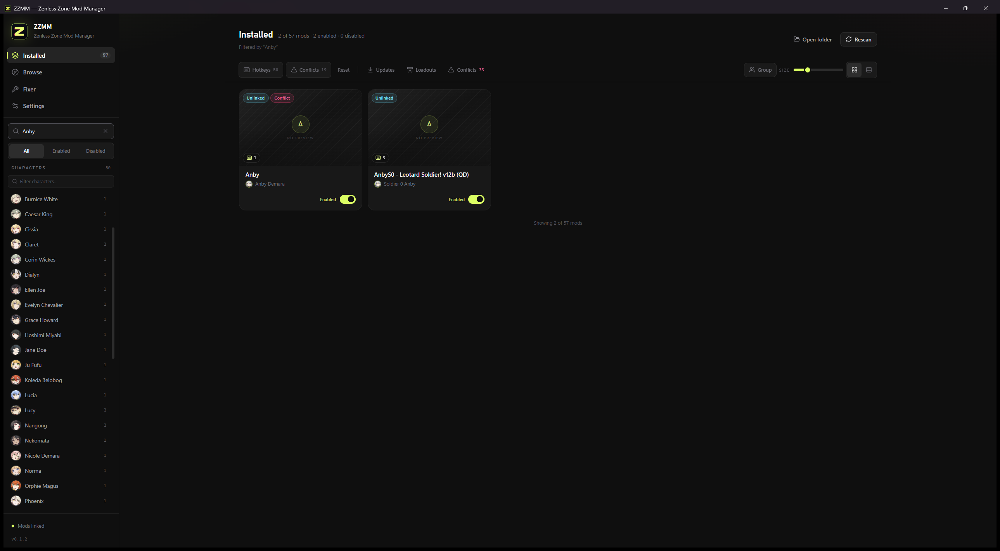
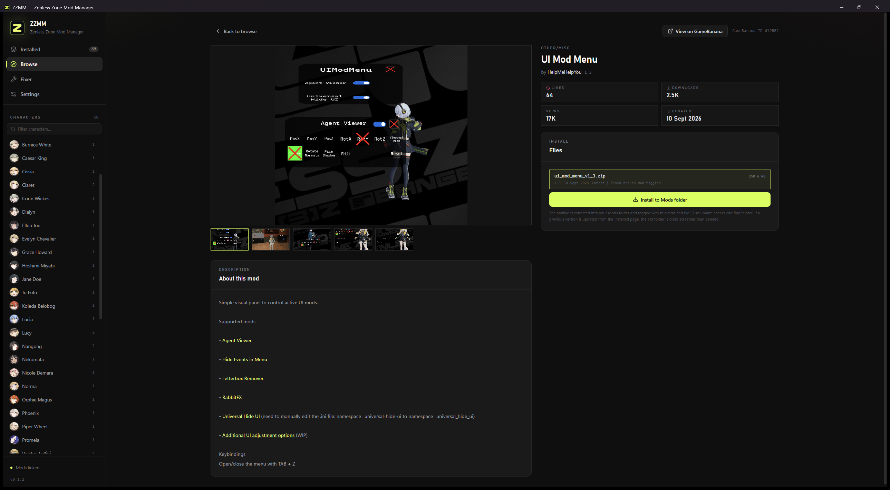

<div align="center">

# ZZMM

[](LICENSE)
[](https://github.com/loaf684/zzmm/releases)
[](#requirements)
[](https://tauri.app)
[](https://www.rust-lang.org)
[](https://www.typescriptlang.org)

<br />


# Zenless Zone Mod Manager

A desktop mod manager for Zenless Zone Zero, built for the ZZMI / XXMI (3DMigoto) loader.

[Download](https://github.com/loaf684/zzmm/releases) · [Documentation](docs/TECHNICAL.md) · [Report bug](https://github.com/loaf684/zzmm/issues) · [Request feature](https://github.com/loaf684/zzmm/issues)

</div>

ZZMM keeps a Zenless Zone Zero mod library organized: it scans your Mods folder, groups mods by character, installs `.zip` / `.7z` / `.rar` archives, checks GameBanana for updates, and previews meshes and textures in 3D. Local-first, with no account and no telemetry.

## Screenshots

<table>
  <tr>
    <td align="center" width="50%">
      
      <br />
      <strong>Installed: mod library grouped by character</strong>
    </td>
    <td align="center" width="50%">
      
      <br />
      <strong>Browse: GameBanana mod page with one-click install</strong>
    </td>
  </tr>
</table>

## Features

- **Library** — scan the Mods folder, group by character, enable/disable with the `DISABLED_` prefix, and flag hash conflicts between enabled mods.
- **Loadouts** — snapshot the library's enabled/disabled state and restore it later without touching mods added afterward.
- **GameBanana** — browse, search, filter and sort ZZZ mods, open a mod page, and install without leaving the app.
- **Updates** — compare stored file IDs against GameBanana; updates install beside the old folder and disable it instead of deleting.
- **Archives** — drop `.zip` / `.7z` / `.rar` anywhere; wrapper folders and multi-mod packs are detected, and existing folders are never overwritten. A new mod is enabled unless another mod for the same character is already installed.
- **3D preview** — render a mod's mesh and decoded DDS textures from its INI, with per-part visibility, wireframe, and controls for the mod's part/visibility toggles (bind pose).
- **Hotkeys** — view and rebind hotkeys inline, detect conflicts across enabled mods, and create a one-time `.ini.bak` on first save.

## Requirements

- Windows 10 or 11 (x64)
- [WebView2 runtime](https://developer.microsoft.com/microsoft-edge/webview2/) — preinstalled on Windows 11 and most Windows 10 machines
- XXMI Launcher with ZZMI to load mods in-game

## Install

Download a prebuilt release:

| Asset | Notes |
| --- | --- |
| `ZZMM_1.0.2_x64-setup.exe` | NSIS installer; per-user, no administrator prompt |
| `ZZMM_1.0.2_x64_en-US.msi` | Windows Installer package |
| `ZZMM_1.0.2_x64_portable.exe` | Standalone; nothing installed, needs WebView2 |

Builds are unsigned, so Windows SmartScreen may warn about an unknown publisher.

### Build from source

Requires Node.js 20+, pnpm 10+, Rust 1.93+ (MSVC), and the C++ Build Tools ("Desktop development with C++").

```bash
pnpm install
pnpm tauri dev      # run the desktop app
pnpm tauri build    # build zzmm.exe and the installers
```

`pnpm dev` serves only the UI; Tauri commands need `pnpm tauri dev`.

| Artifact | Path |
| --- | --- |
| Portable | `src-tauri/target/release/zzmm.exe` |
| NSIS | `src-tauri/target/release/bundle/nsis/ZZMM_1.0.2_x64-setup.exe` |
| MSI | `src-tauri/target/release/bundle/msi/ZZMM_1.0.2_x64_en-US.msi` |

## Quick start

1. Install XXMI Launcher and let it set up ZZMI.
2. Link your `.../XXMI Launcher/ZZMI/Mods` folder in **Settings** (auto-detection suggests common paths).
3. Install a mod by dropping an archive or browsing GameBanana. It is enabled
   automatically, unless another mod for the same character is already installed.
4. Press **F10** in-game to reload ZZMI.

## Architecture

Filesystem, archive, INI, mesh, and texture work runs in Rust behind Tauri commands; React owns presentation and state.

| Layer | Choice |
| --- | --- |
| Shell | Tauri v2 (Rust) |
| UI | React 18 + TypeScript + Vite 6 |
| State | Zustand + React Router 7 |
| 3D | three.js + React Three Fiber |
| Archives | `zip`, `sevenz-rust2`, `unrar` |
| HTTP | `reqwest` + on-disk TTL cache |

See [docs/TECHNICAL.md](docs/TECHNICAL.md) for commands, data layout, and API notes, and [docs/rendering-compatibility.md](docs/rendering-compatibility.md) for mesh and texture behavior.

## Privacy and safety

- GameBanana requests and downloads go directly from your machine; there is no ZZMM proxy or central server, and GameBanana sees your IP address.
- Requests use a stable `ZZMM/<version>` User-Agent, a 300 ms gap, and exponential backoff on HTTP 429. Responses are cached for 30 minutes to 12 hours.
- No telemetry. Settings, loadouts, cache, and downloads live in `%APPDATA%\app.zzmm.desktop`; logs are in `%LOCALAPPDATA%\app.zzmm.desktop\logs\zzmm.log`.
- Mods install as new folders; existing folders are never overwritten, updates disable the old folder, and deletes require confirmation (no Recycle Bin).
- Hotkey saves write a one-time `.ini.bak`; downloaded archives are deleted after installation.

## Known limitations

- Windows only; encrypted ZIP/RAR archives and some 7z codecs are unsupported.
- Character grouping is heuristic; ambiguous names land in **Uncategorized**.
- The 3D preview shows the bind pose (no skinning, morphs, or normal maps); textures are capped at 1024 px and the base mip only.
- Hotkey conflicts compare keys, not `condition` expressions.
- GameBanana descriptions render as plain text, and the API exposes no download-count sort.

See the [technical reference](docs/TECHNICAL.md) for the full list.

## Development

```bash
pnpm typecheck                # tsc --noEmit
pnpm build                    # type-check + bundle
cargo test  --manifest-path src-tauri/Cargo.toml
cargo check --manifest-path src-tauri/Cargo.toml
```

`package.json` has no JS lint or test script. Regenerate icons with `node scripts/generate-icon.mjs` and `pnpm tauri icon src-tauri/app-icon.png -o src-tauri/icons`.

## Credits and license

Thanks to [ZZMI/XXMI](https://github.com/SpectrumQT/XXMI-Launcher), [3DMigoto](https://github.com/bo3b/3Dmigoto), and [GameBanana](https://gamebanana.com); built with Tauri, React, Vite, and three.js.

Issues and pull requests are welcome at [loaf684/zzmm](https://github.com/loaf684/zzmm). [MIT](LICENSE) © 2026 bread.
