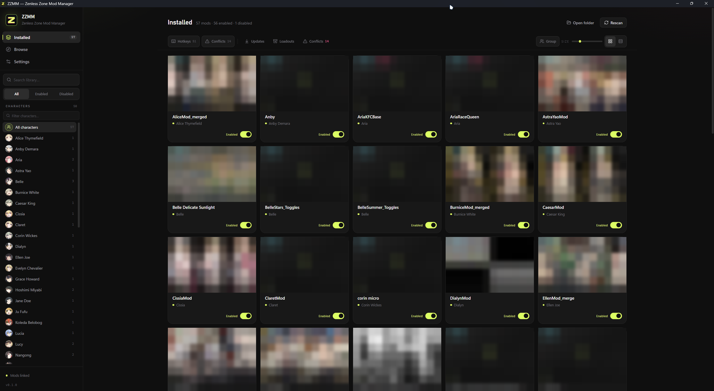
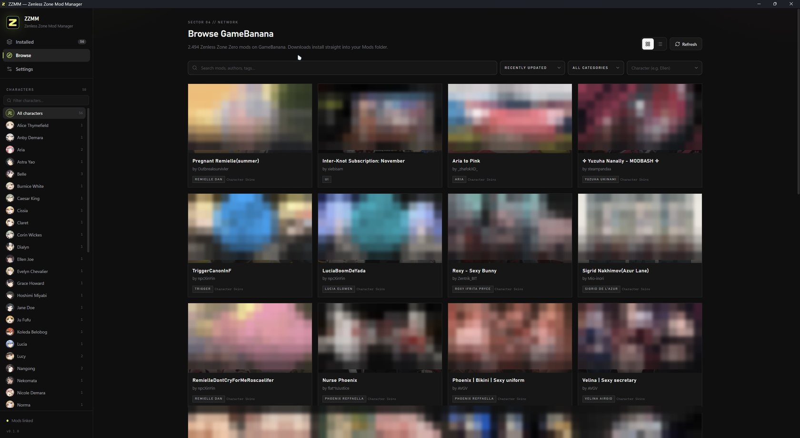
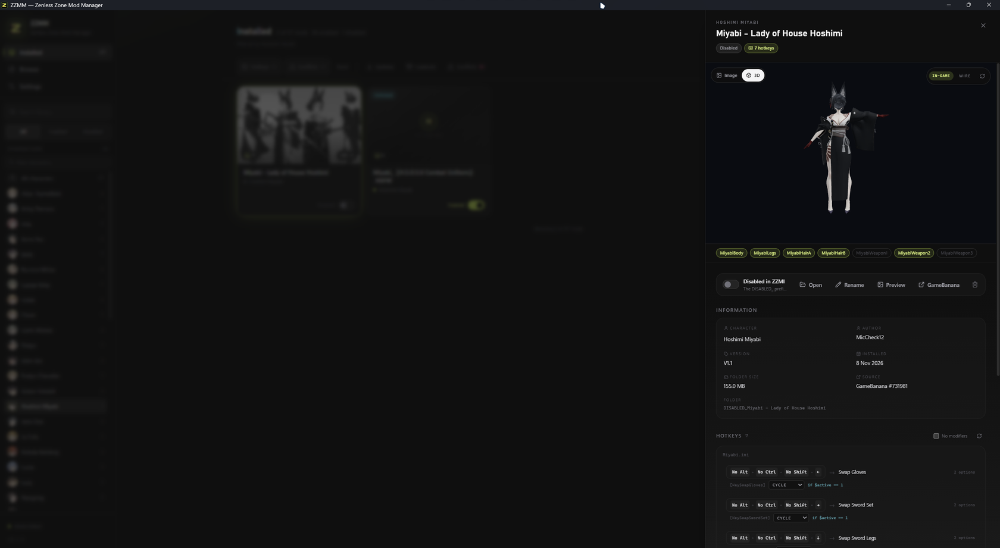

# ZZMM

**A desktop mod manager for Zenless Zone Zero, built for the ZZMI / XXMI (3DMigoto) loader.**

[](LICENSE)
[](https://github.com/loaf684/zzmm/releases)
[](#requirements)
[](https://tauri.app)
[](https://www.rust-lang.org)
[](https://www.typescriptlang.org)

ZZMM keeps a Zenless Zone Zero mod library organized. It scans your Mods folder, groups mods by character, installs `.zip` / `.7z` / `.rar` archives, checks GameBanana for updates, and previews meshes and textures in 3D. It is local-first: no account, no telemetry, and no mod files changed unless you ask.

> [!NOTE]
> **Status:** v0.1.0, Windows 10/11 (x64). Prebuilt installers are on the [Releases](https://github.com/loaf684/zzmm/releases) page.
>
> ZZMM is an independent utility. It is not affiliated with or endorsed by HoYoverse, miHoYo, GameBanana, or the XXMI project. Use mods at your own risk.

## Contents

- [Screenshots](#screenshots)
- [Features](#features)
- [Requirements and installation](#requirements-and-installation)
- [Quick start](#quick-start)
- [Usage notes](#usage-notes)
- [Architecture](#architecture)
- [Privacy and network behavior](#privacy-and-network-behavior)
- [Local safety](#local-safety)
- [Troubleshooting](#troubleshooting)
- [Known limitations](#known-limitations)
- [Development](#development)
- [Contributing](#contributing)
- [Acknowledgements](#acknowledgements)
- [License](#license)

## Screenshots



*Mod library: installed mods grouped by character, with enable/disable toggles.*



*GameBanana browser: search, category and character filters, and inline install.*



*Mod detail: 3D preview, hotkeys, notes, and a link to the source page.*

## Features

**Library**

- Scans immediate subfolders of the Mods folder, including nested INIs up to four levels deep, and tolerates unreadable entries.
- Enable or disable mods with the case-insensitive ZZMI `DISABLED_` prefix; rename, delete (with confirmation), and open in Explorer.
- Groups mods by character from `.zzmm.json`, then a `[Character]` folder prefix, then a best-effort ZZZ roster; anything else is **Uncategorized**. The character can be overridden from the detail panel.
- Sidebar search, enabled-state, and character filters mirror to URL parameters. Optional Group toggle, grid/list views, and remembered card size.
- Flags hash conflicts: `hash` lines shared by two or more **enabled** mods.
- Optional **one active mod per character** disables the others when one is enabled.
- **Loadouts** snapshot the enabled/disabled state of the library and restore it later.

**GameBanana**

- Browse Zenless Zone Zero mods (game ID `19567`) with search, category and character filters, and **Newest**, **Trending**, and **Recently updated** sorting.
- Detail pages show a gallery, stats, a file list with sizes and dates, and an install button.
- Installs download to the app data folder and reuse the same archive pipeline; each installed folder gets a `.zzmm.json`.
- **Update checks** compare the stored file ID (falling back to version) against GameBanana. An update installs beside the old folder and disables it instead of deleting.

**Archives**

- Drop `.zip`, `.7z`, or `.rar` files anywhere in the window; the type is detected from magic bytes.
- Wrapper folders are transparent, and packs with several mods install as separate folders.
- Name collisions get ` (2)`, ` (3)` suffixes; an existing folder is never overwritten.
- Extraction uses a staging folder inside the Mods directory and is always cleaned up.

**3D preview**

- Parses `[Resource*]` sections, decodes ZZZ vertex and index buffers, and renders BC1–BC7 DDS textures.
- Orbit, zoom, pan, wireframe, and per-component visibility; the camera frames the mesh bounds.
- Parts render in bind pose; blend buffers and skinning are not applied.

**Hotkeys**

- Lossless, line-based INI parser preserves ordering, comments, blank lines, and CRLF/LF endings.
- Rebind keys inline, set the action type (`activate`, `hold`, `toggle`, `cycle`), and detect conflicts across enabled mods.
- The first save of a file creates a one-time `<name>.ini.bak`.

## Requirements and installation

### Requirements

- **Windows 10 or 11 (x64).**
- **WebView2 runtime** — preinstalled on Windows 11 and most Windows 10 machines. If it is missing, install the [Evergreen WebView2 Runtime](https://developer.microsoft.com/microsoft-edge/webview2/).
- **XXMI Launcher with ZZMI** to load mods into the game.

### Install a prebuilt release

Download from the [Releases](https://github.com/loaf684/zzmm/releases) page:

| Asset | Notes |
| --- | --- |
| `ZZMM_0.1.0_x64-setup.exe` | NSIS installer; installs for the current user, no administrator prompt. |
| `ZZMM_0.1.0_x64_en-US.msi` | Windows Installer (MSI) package. |
| `ZZMM_0.1.0_x64_portable.exe` | Standalone executable; nothing is installed. Requires WebView2. |

Release builds are unsigned, so Windows SmartScreen may warn about an unknown publisher.

### Build from source

Requirements: Node.js 20+, pnpm 10+, Rust 1.93+ with the MSVC toolchain, and the Microsoft C++ Build Tools with the "Desktop development with C++" workload (also needed to compile the vendored UnRAR extractor).

```bash
pnpm install
pnpm tauri dev
```

`pnpm dev` alone serves the UI in a browser, but Tauri commands fail with a "desktop backend is not available" error. Use `pnpm tauri dev` for the real app.

Build the executable and Windows installers:

```bash
pnpm tauri build
```

| Artifact | Path |
| --- | --- |
| Portable executable | `src-tauri/target/release/zzmm.exe` |
| NSIS installer | `src-tauri/target/release/bundle/nsis/ZZMM_0.1.0_x64-setup.exe` |
| MSI installer | `src-tauri/target/release/bundle/msi/ZZMM_0.1.0_x64_en-US.msi` |

## Quick start

1. Install XXMI Launcher and let it set up ZZMI.
2. Open ZZMM and link your `.../XXMI Launcher/ZZMI/Mods` folder in **Settings**. Auto-detection suggests common locations.
3. Install a mod: drag an archive into the window, or browse GameBanana and install from a mod page.
4. Enable the mod in the library, then press **F10** in-game to reload ZZMI.

## Usage notes

**Loadouts.** A loadout records the enabled/disabled state of every mod present when it was saved. Applying one switches only mods that still exist, reports missing entries, and leaves mods installed after the snapshot untouched.

**Updates.** Update checks read the file ID stored in each mod's `.zzmm.json` and compare it with the newest GameBanana file. An update installs as a new folder and disables the previous one, so the old version stays on disk.

**Hotkey editing.** Open a mod, pick a binding under **Hotkeys**, and rebind it. Only the `key` and `type` settings are written; there is no raw INI editor. Conflicts are checked against other enabled mods when the panel opens.

**Drag-and-drop installs.** Drop one or more archives anywhere in the window. Progress appears in a floating panel. Wrapper folders are stripped, and multi-mod archives install each mod as its own folder.

## Architecture

All filesystem, archive, INI, mesh, and texture work runs in Rust behind Tauri commands. React owns presentation and state.

| Layer | Choice |
| --- | --- |
| Shell | Tauri v2 (Rust) |
| UI | React 18 + TypeScript + Vite 6 |
| Styling | TailwindCSS 3.4 (dark theme) |
| State | Zustand |
| Routing | React Router 7 (`HashRouter`) |
| 3D | three.js + `@react-three/fiber` + `@react-three/drei` |
| Archives | `zip`, `sevenz-rust2`, `unrar` |
| HTTP | `reqwest` (SChannel TLS on Windows) + on-disk TTL cache |

```text
src/                 React UI, stores, API wrappers
src-tauri/src/       Rust backend and Tauri commands
  api/               GameBanana client, TTL cache, downloads, updates
  installer/         ZIP / 7z / RAR extraction and mod-root detection
  ini_parser/        Lossless INI parsing, hotkeys, conflicts
  mesh_loader/       3D preview mesh construction
  texture/           DDS header parsing and BCn decoding
docs/                Technical reference and rendering notes
```

See [docs/TECHNICAL.md](docs/TECHNICAL.md) for IPC commands, data layout, release steps, and GameBanana API constraints. See [docs/rendering-compatibility.md](docs/rendering-compatibility.md) for mesh and texture resolution.

## Privacy and network behavior

GameBanana requests and mod downloads go **directly from your machine** to GameBanana; there is no ZZMM proxy or central API server. GameBanana receives the usual network information, including your IP address.

Requests use a stable `ZZMM/<version> (ZZMI mod manager; +https://github.com/loaf684/zzmm)` User-Agent, a 300 ms gap between request starts, and exponential backoff with `Retry-After` support on HTTP 429. Update checks are capped at 25 mods.

Responses are cached on disk: browse and search 30 minutes, mod detail 2 hours, update checks 30 minutes, categories 12 hours.

ZZMM collects no telemetry. Settings, loadouts, cache, and downloads stay in the app's local data folders. Downloaded archives are deleted after installation.

| Data | Location |
| --- | --- |
| Settings | `%APPDATA%\app.zzmm.desktop\settings.json` |
| Loadouts | `%APPDATA%\app.zzmm.desktop\loadouts.json` |
| State backups | `%APPDATA%\app.zzmm.desktop\backups\mod-state-*.json` |
| API cache | `%APPDATA%\app.zzmm.desktop\cache\gamebanana\*.json` |
| Downloads | `%APPDATA%\app.zzmm.desktop\downloads\` (deleted after install) |
| Logs | `%LOCALAPPDATA%\app.zzmm.desktop\logs\zzmm.log` |

## Local safety

- Mods are installed as new folders; an existing folder is never overwritten.
- Updating a mod disables the previous folder instead of deleting it.
- Batch enable/disable actions write a `backups/mod-state-*.json` snapshot before renaming folders and report per-mod failures.
- Hotkey saves create a one-time `.ini.bak` before an atomic write.
- Delete is permanent (no Recycle Bin) and requires confirmation in the UI.
- Downloaded archives are deleted after installation; archives you drag in stay where they are.
- Folder and file-name commands accept a single folder name and verify it resolves to a direct child of the configured Mods folder.

## Troubleshooting

| Symptom | Fix |
| --- | --- |
| `pnpm tauri dev` opens no window | The WebView2 runtime is missing. Install the [Evergreen WebView2 Runtime](https://developer.microsoft.com/microsoft-edge/webview2/). |
| Commands fail when running in a browser | `pnpm dev` serves only the UI. Use `pnpm tauri dev`; the browser has no desktop backend. |
| A mod change does not appear in-game | 3DMigoto reads the Mods folder on reload. Press **F10** in-game; ZZMM shows a reminder after each change. |
| GameBanana requests fail or return HTTP 429 | GameBanana is rate limiting. ZZMM already spaces requests and backs off; wait a minute and retry. |
| SmartScreen blocks the installer | Release builds are unsigned. Choose **More info → Run anyway**, or build from source. |
| An operation failed and only a notice is shown | Check `%LOCALAPPDATA%\app.zzmm.desktop\logs\zzmm.log` for errors and warnings. |

## Known limitations

- Windows only.
- Encrypted ZIP and RAR archives are unsupported, and some uncommon 7z codecs are disabled.
- Character grouping for unlinked mods is heuristic; ambiguous names land in **Uncategorized**.
- The 3D preview shows the bind pose: blend buffers, skinning, morphs, and vertex colours are not applied. Normal maps are ignored.
- Texture previews decode only the base mip and are capped at 1024 px.
- GameBanana descriptions render as plain text, so author colours, font sizes, and inline images are not reproduced.
- Hotkey conflict detection compares keys, not `condition` expressions.
- The GameBanana character filter is a substring match on subcategory names, so it can match unrelated mods.
- GameBanana exposes no download-count sort through the API used here.
- Delete is permanent; there is no Recycle Bin integration.
- Some parts have no diffuse texture on disk (game-captured or runtime-shader textures) and render neutral with a warning. See [rendering compatibility](docs/rendering-compatibility.md).

See the [technical reference](docs/TECHNICAL.md) for the full list.

## Development

```bash
pnpm install                  # install dependencies
pnpm tauri dev                # run the desktop app with hot reload
pnpm typecheck                # tsc --noEmit
pnpm build                    # type-check and build the frontend bundle
pnpm tauri build              # build the executable and Windows installers
```

Rust checks:

```bash
cargo test  --manifest-path src-tauri/Cargo.toml
cargo check --manifest-path src-tauri/Cargo.toml
cargo fmt   --manifest-path src-tauri/Cargo.toml
```

`package.json` has no JavaScript lint or test script; `pnpm typecheck` and the Rust tests are the checks that exist. Clippy is optional and needs the component first:

```bash
rustup component add clippy
cargo clippy --manifest-path src-tauri/Cargo.toml --all-targets -- -D warnings
```

Regenerate the app icon from `src-tauri/app-icon.png`:

```bash
node scripts/generate-icon.mjs
pnpm tauri icon src-tauri/app-icon.png -o src-tauri/icons
```

The release checklist lives in [docs/TECHNICAL.md](docs/TECHNICAL.md).

## Contributing

Issues and pull requests are welcome at [loaf684/zzmm](https://github.com/loaf684/zzmm). Keep changes focused, and run `pnpm typecheck` plus the Rust tests before sending a pull request.

## Acknowledgements

- [ZZMI / XXMI](https://github.com/SpectrumQT/XXMI-Launcher) and [3DMigoto](https://github.com/bo3b/3Dmigoto) provide the mod loader this app targets.
- [GameBanana](https://gamebanana.com) hosts the mods and the API used by the browser.
- [RARLab UnRAR](https://www.rarlab.com/rar_add.htm) is the extractor statically linked for RAR support.
- Built with [Tauri](https://tauri.app), [React](https://react.dev), [Vite](https://vite.dev), [three.js](https://threejs.org), [Zustand](https://github.com/pmndrs/zustand), [React Router](https://reactrouter.com), [TailwindCSS](https://tailwindcss.com), and [lucide](https://lucide.dev).

## License

[MIT](LICENSE) © 2026 bread